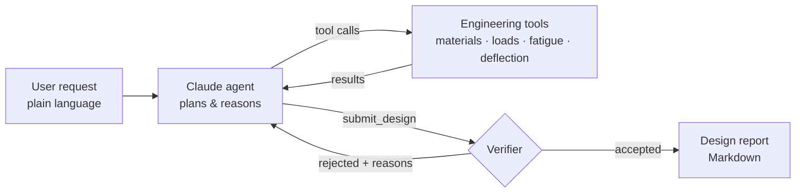

# ShaftPilot 

**An AI agent that designs machine shafts and proves its numbers.**

You describe a shaft in plain language:

> *"Input shaft of a small gearbox: 5 kW motor at 1450 rpm, spur gear with 2.5 kN radial force
> 120 mm from the left bearing, 300 mm bearing span, safety factor 2, as cheap as possible."*

ShaftPilot works out the load case, tries different materials and diameters, checks each one for
**fatigue, yield, deflection and bearing slope**, and gives you a verified design plus a design
report. It works the way an engineer would.

---

## Why this is an *agentic* project

A normal chatbot would just answer *"use a 30 mm C45 shaft"*. That answer might be wrong, and
you couldn't check it. ShaftPilot works differently:

| | Chatbot | ShaftPilot |
|---|---|---|
| Who does the maths? | The language model (it can make up numbers) | Deterministic Python tools |
| How many designs are tried? | One guess | Several: it searches materials × diameters |
| What happens when a check fails? | You find out later | The agent sees *which* check failed and adapts |
| Can it hand in a bad design? | Yes | No: a verifier re-checks every submission and rejects failures |
| Can you trace its work? | No | Every tool call is logged in the report |

**Core idea:** *The LLM decides what to try. The tools decide whether it works.*

### The guardrails

1. **Locked requirements.** The agent must first call `set_requirements`. Every later check runs
   against that locked load case, so the agent can't quietly weaken the loads to make a design pass.
2. **No mental arithmetic.** Stresses, safety factors and deflections only come from tools.
3. **Independent verifier.** `submit_design` re-runs every check itself. It rejects designs that
   fail, that use non-standard diameters, that break a constraint, or that use unrealistic stress
   concentration factors (< 1.0). The agent gets told what was wrong and has to fix it.
4. **Explicit assumptions.** Anything the user didn't say (surface finish, notch factor, …) has to
   be written down as an assumption and appears in the report for a human to check.

## Architecture



| File | What it does |
|---|---|
| `shaftpilot/mechanics.py` | The engineering maths (torque, bending, DE-Goodman fatigue, deflection, standard diameters) |
| `shaftpilot/materials.py` | Shaft steels: S235JR … 34CrNiMo6, with strength, fatigue limit, cost index |
| `shaftpilot/tools.py` | The agent's tools, the locked requirements and the verifier |
| `shaftpilot/agent.py` | The agent loop (Claude tool use) |
| `shaftpilot/offline.py` | Scripted planner using the same tools (demo without an API key) |
| `shaftpilot/report.py` | Builds the design report from verified results only |

## Quick start

```bash
git clone https://github.com/<your-username>/shaftpilot.git
cd shaftpilot
pip install -r requirements.txt
```

**1. Demo without an API key** (scripted planner, same tools and verifier):

```bash
python -m shaftpilot --offline examples/gearbox_input_shaft.json
python -m shaftpilot --offline examples/conveyor_drive_shaft.json
```

**2. The real agent** (needs an [Anthropic API key](https://console.anthropic.com)):

```bash
export ANTHROPIC_API_KEY=sk-ant-...
python -m shaftpilot "Drive shaft for a belt conveyor: 15 kW at 90 rpm, pulley load 12 kN in the \
middle of a 600 mm bearing span, safety factor 2.5, must fit in 80 mm, lightest possible."
```

The report is written to `shaftpilot_report.md` (change it with `--report`).

**3. Run the tests:**

```bash
pip install pytest
python -m pytest
```

The tests check the formulas against hand calculations and textbook cases. They also run the full
agent loop with a fake LLM that makes a mistake on purpose, to show the verifier catching it.

## Example: what the agent finds

Conveyor drive shaft, 15 kW at 90 rpm, 12 kN at mid-span, safety 2.5, max 80 mm, lightest:

```
🔧 check_shaft(diameter_mm=80, material=C45+N)
   ↳ Ø80 C45+N: n_f=2.41 ...                     -> FAIL fatigue
🔧 check_shaft(diameter_mm=80, material=C45+QT)
   ↳ Ø80 C45+QT: n_f=2.64 ...                    -> PASS
🔧 check_shaft(diameter_mm=70, material=42CrMo4+QT)
   ↳ Ø70 42CrMo4+QT: n_f=2.55, f=0.218/0.180 mm  -> FAIL deflection, bearing_slope
🔧 check_shaft(diameter_mm=75, material=42CrMo4+QT)
   ↳ Ø75 42CrMo4+QT: n_f=3.11, f=0.166/0.180 mm  -> PASS
✅ Verified design: Ø 75 mm, 42CrMo4+QT
```

The insight: the high-strength steel would be *strong enough* at 70 mm, but *not stiff enough*.
All steels have about the same Young's modulus (210 GPa), so only a bigger diameter fixes
deflection. The agent is told to reason about *which* check fails, not just retry.

Full sample reports: [`examples/report_gearbox_offline.md`](examples/report_gearbox_offline.md),
[`examples/report_conveyor_offline.md`](examples/report_conveyor_offline.md).

## Engineering methods

* Torque: `T = P / ω`
* Bending (simply supported, point load at `a`): `M = F·a·b / L`, `σ_b = 32M / (πd³)`
* Torsion: `τ_t = 16T / (πd³)`
* Fatigue: **DE-Goodman** (Shigley): `1/n = K_f·σ_a/S_e + √3·K_fs·τ_m/R_m`, with
  `S_e = k_a·k_b·σ_bW` (Marin surface and size factors). Rotating shaft → fully reversed bending;
  constant torque → steady torsion.
* Static yield: `n_y = R_e / √((K_f σ_b)² + 3(K_fs τ_t)²)`
* Deflection at load: `f = F a² b² / (3EIL)`, limit `0.0003·L` (Roloff/Matek guideline)
* Bearing slope: `θ = F b (L² − b²) / (6EIL)`, limit 0.001 rad (deep groove ball bearings)
* Standard diameters based on DIN 748

## Limitations (honest list)

* One radial load, two bearings, constant diameter. Real shafts have steps, several gears and axial loads.
* Material values are typical textbook values, not supplier data.
* A concept-design check, **not** a full DIN 743 verification.

## Roadmap

- [ ] Stepped shafts and several loads (beam model with superposition)
- [ ] Bearing selection agent (L10 life) and key/feather-key check
- [ ] Export a parametric CAD sketch (e.g. FreeCAD / STEP)
- [ ] Multi-agent setup: a "designer" agent and a separate "reviewer" agent
- [ ] Web UI with a live view of the agent's reasoning

## Author

Rudra Bhartia, Mechanical Engineering student at KIT (Karlsruhe Institute of Technology).

License: MIT
